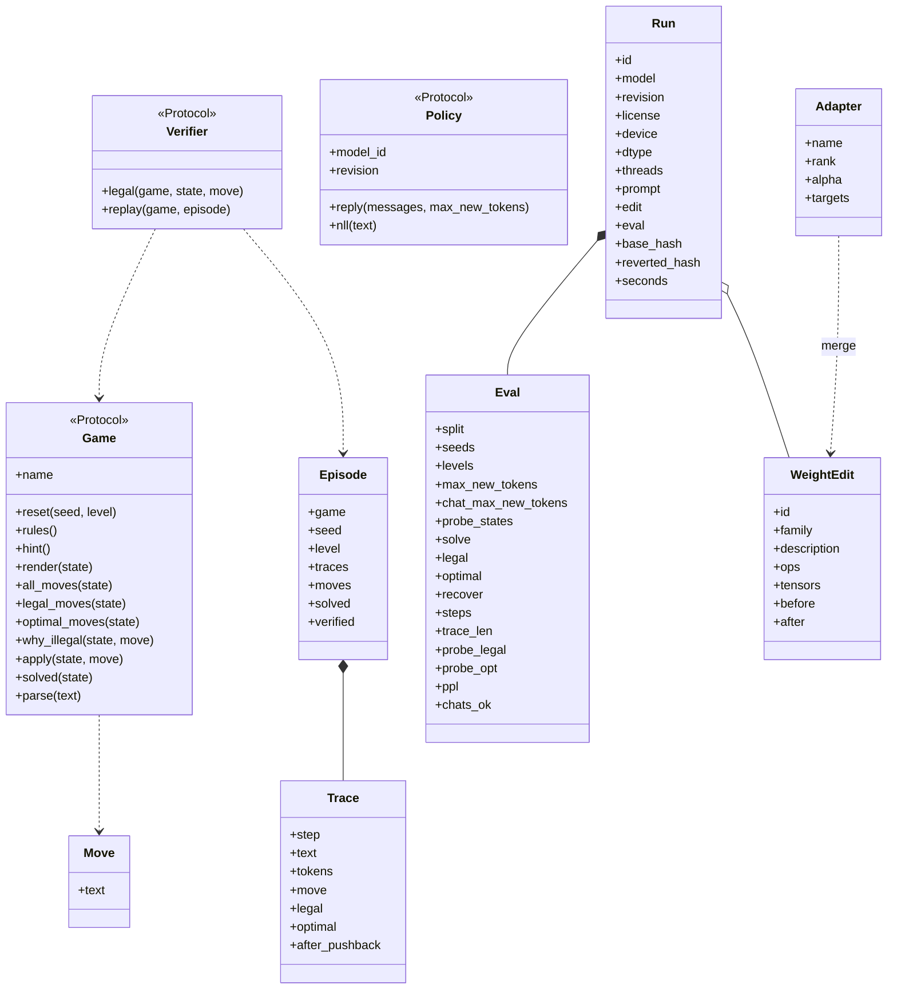
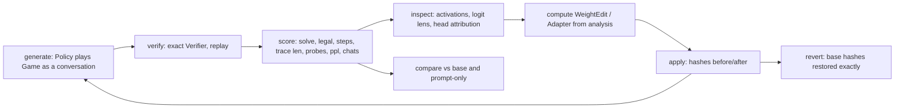

# Spec diagrams

One box per type in `spec/interfaces.py` (member names must match; `tools/spec_check.py`).

## Loop

No gradient step anywhere: "train" in the project loop is replaced by "compute edit, apply, revert".

