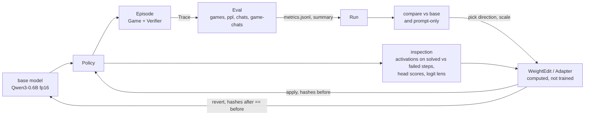

# Spec diagrams

Boxes are generated from `spec/interfaces.py` by `tools/spec_check.py --write`; the loop below is hand-written.
`tools/spec_check.py` fails when a box and its spec class disagree, or an implementation in `tr/` misses a Protocol method.

## The loop

Order per edit: inspect, compute, `WeightEdit.apply`, `Eval.all` (three measures), `Run.summary`, `WeightEdit.revert`, `verify("before")`.

## Boxes

```mermaid
classDiagram
  class Move {
    <<dataclass>>
    +text: str
    +action: Optional[Action]
  }
  class Game {
    <<protocol>>
    +name: str
    +levels: Sequence[int]
    +new(level, seed) State
    +legal_moves(state) Sequence[Action]
    +apply(state, action) State
    +optimal_steps(state) int
    +render(state) str
    +rules() str
    +parse(text) Optional[Action]
    +format(action) str
    +encode(state) JSON
    +decode(data) State
  }
  class Verifier {
    <<protocol>>
    +game: Game
    +legal(state, action) bool
    +solved(state) bool
    +explain(state, action) str
  }
  class Message {
    <<dataclass>>
    +role: str
    +content: str
  }
  class Generation {
    <<dataclass>>
    +text: str
    +reasoning: str
    +n_tokens: int
    +truncated: bool
  }
  class PolicyConfig {
    <<dataclass>>
    +model: str
    +revision: str
    +variant: str
    +dtype: str
    +device: str
    +thinking: bool
    +max_new_tokens: int
    +temperature: float
    +seed: int
  }
  class Policy {
    <<protocol>>
    +config: PolicyConfig
    +model: Any
    +tokenizer: Any
    +generate(messages) Generation
    +nll(text) tuple[float, int]
    +tensor(name) Tensor
    +tensor_names() Sequence[str]
  }
  class Step {
    <<dataclass>>
    +turn: int
    +prompt: str
    +reasoning: str
    +move: Optional[Move]
    +legal: bool
    +solved_after: bool
    +n_tokens: int
    +error: Optional[str]
  }
  class Trace {
    <<dataclass>>
    +game: str
    +level: int
    +seed: int
    +mode: str
    +variant: str
    +steps: list[Step]
    +solved: bool
    +optimal_steps: int
    +n_illegal: int
    +n_unparseable: int
    +reasoning_tokens: int
    +wall_s: float
  }
  class EpisodeConfig {
    <<dataclass>>
    +mode: str
    +max_turns: int
    +max_illegal: int
    +show_legal: bool
    +cot_prompt: bool
  }
  class Episode {
    <<protocol>>
    +game: Game
    +verifier: Verifier
    +policy: Policy
    +config: EpisodeConfig
    +play(level, seed) Trace
    +messages() Sequence[Message]
  }
  class GameSuite {
    <<dataclass>>
    +game: str
    +levels: Sequence[int]
    +seeds: Sequence[int]
    +episode: EpisodeConfig
  }
  class TextSuite {
    <<dataclass>>
    +path: str
    +max_docs: int
  }
  class ChatSuite {
    <<dataclass>>
    +path: str
    +max_chats: int
  }
  class GameMetrics {
    <<dataclass>>
    +game: str
    +level: int
    +n: int
    +solve_rate: float
    +legal_rate: float
    +mean_steps: float
    +mean_optimal: float
    +mean_reasoning_tokens: float
    +mean_wall_s: float
  }
  class TextMetrics {
    <<dataclass>>
    +path: str
    +n_docs: int
    +n_tokens: int
    +ppl: float
  }
  class ChatMetrics {
    <<dataclass>>
    +path: str
    +n_chats: int
    +mean_reply_tokens: float
    +truncated_rate: float
    +repeat_rate: float
    +transcripts_dir: str
  }
  class EvalResult {
    <<dataclass>>
    +variant: str
    +games: list[GameMetrics]
    +text: Optional[TextMetrics]
    +chats: Optional[ChatMetrics]
    +game_chats: list[GameMetrics]
  }
  class Eval {
    <<protocol>>
    +run: 'Run'
    +games(policy, suite) list[GameMetrics]
    +text(policy, suite) TextMetrics
    +chats(policy, suite) ChatMetrics
    +all(policy, games, text, chats) EvalResult
  }
  class RunConfig {
    <<dataclass>>
    +policy: PolicyConfig
    +games: Sequence[GameSuite]
    +text: TextSuite
    +chats: ChatSuite
    +edit: Optional[str]
    +adapter: Optional[str]
    +note: str
  }
  class Run {
    <<protocol>>
    +id: str
    +dir: str
    +config: RunConfig
    +write_config() None
    +log(record) None
    +summary(result) str
    +save_trace(trace) str
    +save_chat(chat_id, messages) str
  }
  class TensorChange {
    <<dataclass>>
    +name: str
    +hash_before: str
    +hash_after: str
    +how: JSON
  }
  class LoraTarget {
    <<dataclass>>
    +tensor: str
    +A: Tensor
    +B: Tensor
    +alpha: float
  }
  class Adapter {
    <<protocol>>
    +id: str
    +rank: int
    +targets: Sequence[LoraTarget]
    +merge(policy) 'WeightEdit'
    +save(path) None
    +load(path) 'Adapter'
  }
  class WeightEdit {
    <<protocol>>
    +id: str
    +kind: str
    +changes: list[TensorChange]
    +applied: bool
    +apply(policy) None
    +revert(policy) None
    +verify(policy, expect) bool
    +save(path) None
    +load(path) 'WeightEdit'
  }
```

<!-- BOXES BEGIN (generated by tools/spec_check.py --write) -->

<!-- BOXES END -->
